<div align="center">

# VCUnlock

**Play GTA Vice City at any frame rate.**<br>
The game still runs at 30 Hz underneath, so nothing breaks.

[](https://github.com/ilkaydnc/VCUnlock/releases/latest)
[](https://github.com/ilkaydnc/VCUnlock/actions/workflows/build.yml)

### [Download VCUnlock.zip](https://github.com/ilkaydnc/VCUnlock/releases/latest/download/VCUnlock.zip)

<sub>Steam, retail 1.0 and Japanese · Windows 10 and 11 · one DLL, no game files changed</sub>

</div>

> [!NOTE]
> VCUnlock is an unofficial fan project. It needs your own copy of GTA Vice City, from Steam, the retail 1.0 release or the Japanese release, and contains no game code or files. It is not affiliated with Rockstar Games or Take-Two Interactive.

<!-- video -->

## Why

Vice City was made for 30 fps. Its physics move one step per frame, so when you turn the frame limiter off, the game runs faster than it should: cars stop dead, helicopters climb too fast and boats crawl.

VCUnlock lets you play at your monitor's refresh rate while the game keeps running at 30 steps a second, exactly like the original.

## Features

| | Original | VCUnlock |
|---|---|---|
| **Frame rate** | 30 fps cap | VSync, any cap or uncapped |
| **Physics and timers** | Break above 30 fps | Same at any frame rate |
| **Draw distance** | 300 m | Up to 540 m |
| **Building fade-in** | 0.06 s at 240 fps | 0.5 s at any frame rate |
| **Wide screen** | Cropped, HUD stretched, aim off | Wider view, HUD and aim right |
| **Display** | Exclusive fullscreen | Fullscreen, borderless or window |
| **Settings** | Frame Limiter on or off | New options in the game's menus |
| **Map Legend** | Turns on by itself | Fixed |
| **Audio Setup** | Can crash after alt-tab | Fixed |
| **Screensaver, power** | Changed system-wide | Left alone |

## How it works

The game world (physics, AI, scripts, timers) updates 30 times a second, the same as the original with its limiter on. Your screen can show many more frames than that, so each frame is drawn between the last two world updates. Motion looks smooth, and the game underneath is unchanged.

| Part | On screen |
|---|---|
| Peds, vehicles, objects and skeletons | Smooth |
| Doors, bonnet, boot, wheels and steering | Smooth |
| Suspension, bike forks and lean, lights | Smooth |
| Cutscene characters, props and cameras | Smooth |
| Follow and scripted cameras | Smooth, mouse look every frame |
| Particles, water waves, trees and rain | Smooth |
| Markers, bullet traces, glass and ropes | Smooth |
| Plane trails, coronas and the sun | Smooth |
| HUD flashes, radio and sound fades | Every frame, at 30 fps speed |
| Engine pitch, water scroll, swinging doors | Every frame, at 30 fps speed |
| Heli rotors, animated textures, most clothing | 30 steps a second |
| Keyboard and gamepad | Read 30 times a second |

## Draw distance

The Draw Distance slider lets objects show up further away, but the game only searches for them within 300 m of the camera. Beyond that it falls back to low-detail models, so the top half of the slider did almost nothing.

VCUnlock makes the search follow the slider, up to 540 m (600 m in a helicopter), and enlarges what a longer search needs:

| | Original | VCUnlock |
|---|---|---|
| Search distance | 300 m | Follows the slider |
| Visible object list | 2,000, unchecked | 16,384, checked |
| Fading and see-through objects | 200 | 1,000 |
| Streaming memory | 45 MB | 192 MB |

Each row is one frozen frame drawn twice with Draw Distance at maximum. Purple marks what changed.

<table>
  <tr>
    <th>Original</th>
    <th>VCUnlock</th>
    <th>Difference</th>
    <th>Flip</th>
  </tr>
  <tr>
    <td colspan="4"><b>Airport, in a helicopter</b>: 600 m instead of 300 m</td>
  </tr>
  <tr>
    <td>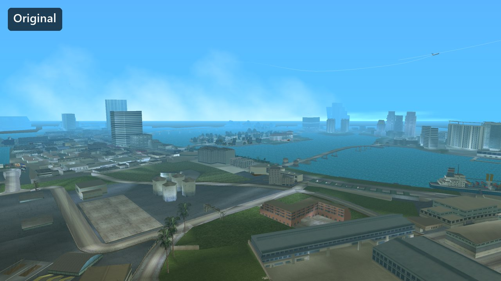</td>
    <td>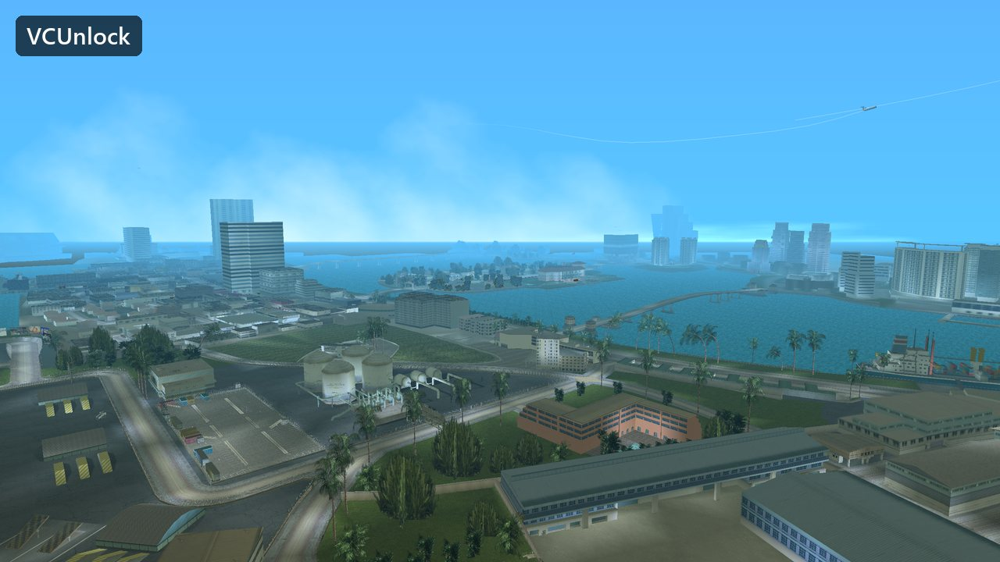</td>
    <td>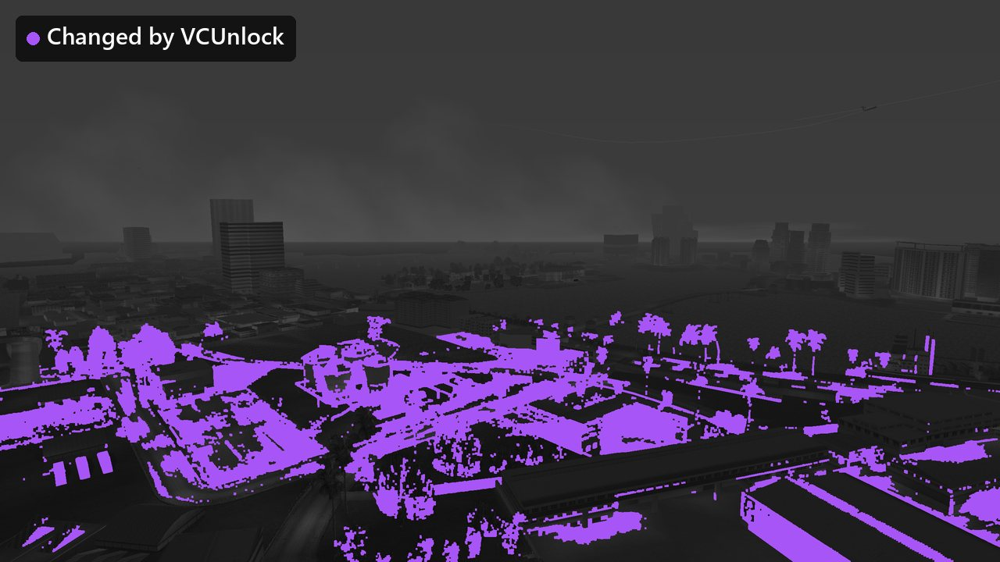</td>
    <td></td>
  </tr>
  <tr>
    <td colspan="4"><b>Ocean Beach, in a helicopter</b>: 600 m instead of 300 m</td>
  </tr>
  <tr>
    <td>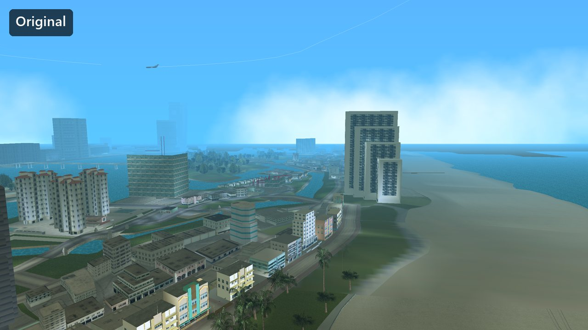</td>
    <td>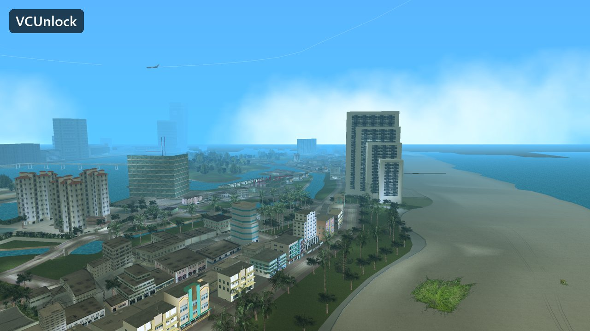</td>
    <td>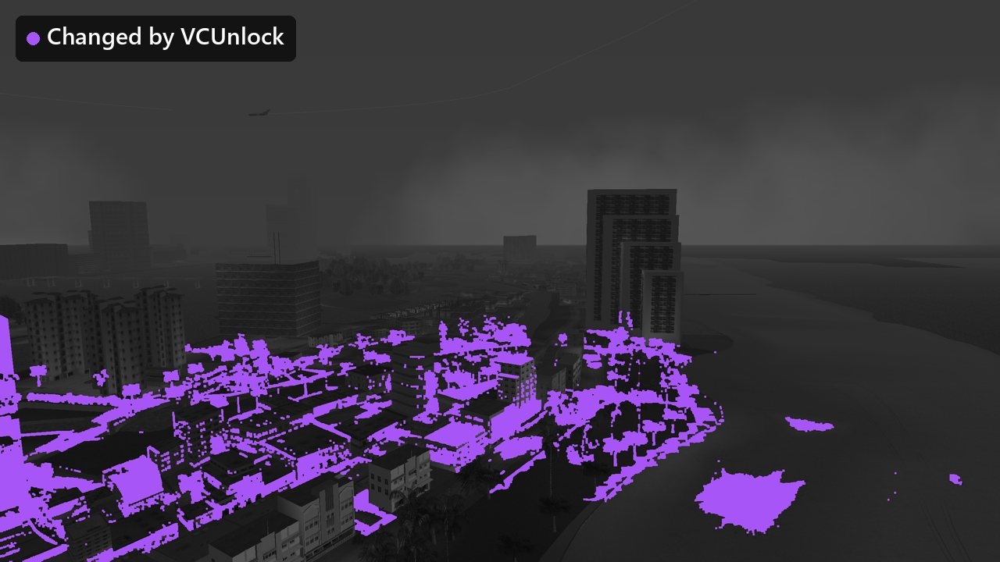</td>
    <td></td>
  </tr>
  <tr>
    <td colspan="4"><b>Downtown, in a helicopter</b>: 600 m instead of 300 m</td>
  </tr>
  <tr>
    <td></td>
    <td>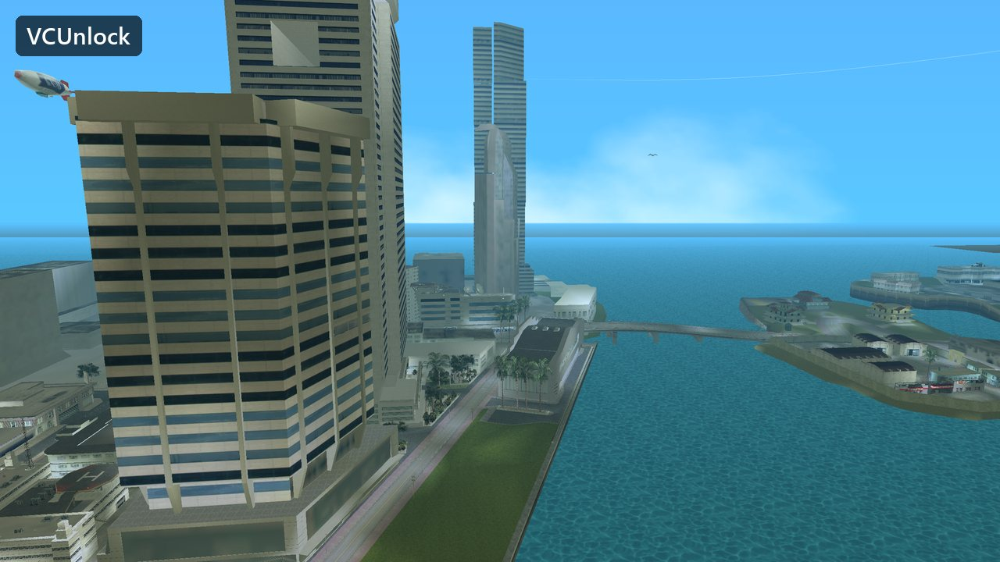</td>
    <td>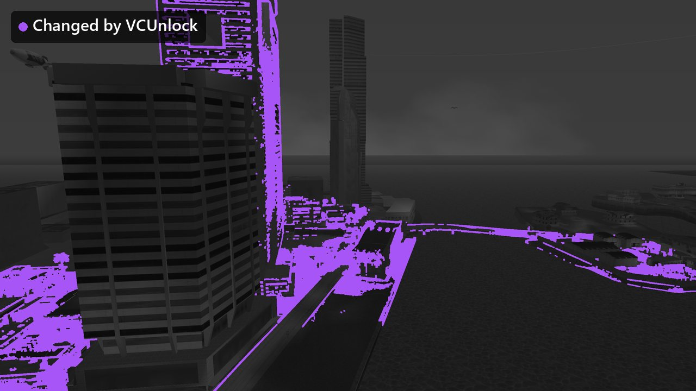</td>
    <td>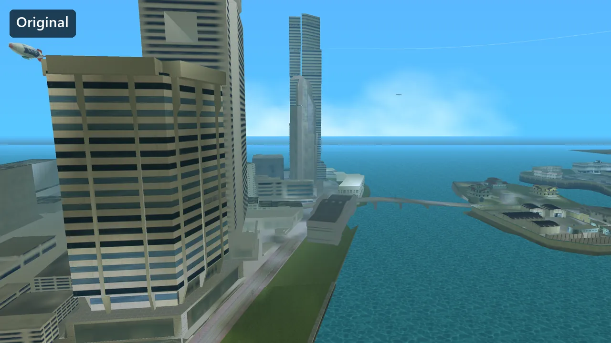</td>
  </tr>
  <tr>
    <td colspan="4"><b>Airport</b>: 540 m instead of 300 m</td>
  </tr>
  <tr>
    <td>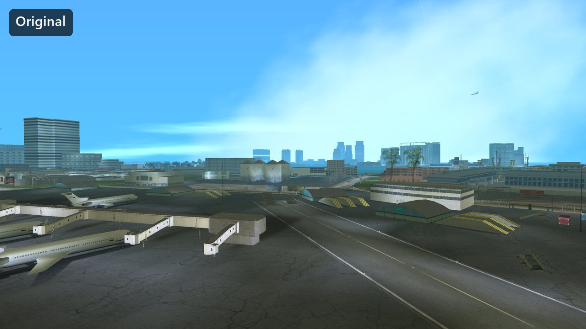</td>
    <td>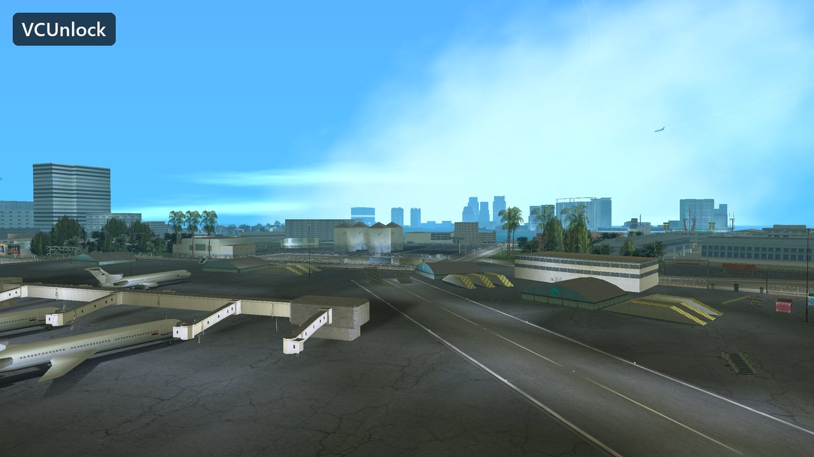</td>
    <td>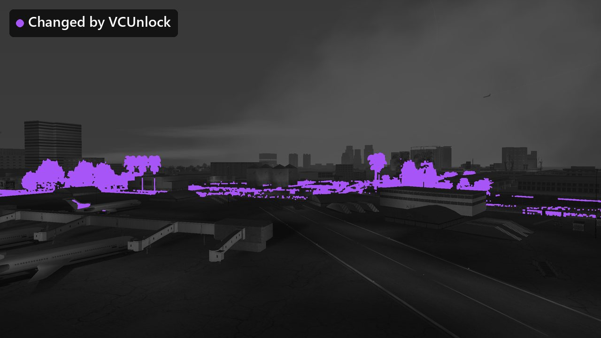</td>
    <td></td>
  </tr>
</table>

## Wide screen

The original stretches its 4:3 picture, HUD included, across a wide screen. Its own **Wide Screen** option cuts off the top and bottom of the view instead, leaves the HUD stretched and keeps the 4:3 aim maths, so shots miss the crosshair.

VCUnlock's **Wide Screen** replaces it. On, it keeps the 4:3 view, shows more on the sides, draws the HUD, radar and text in the right shape and keeps shots in the crosshair. Off, the picture is stretched as in the original. At 4:3 nothing changes.

Each picture below is one M4 shot fired by the game from the same frozen frame. The line is the shot's path, green when it lands in the crosshair and red when it misses.

<table>
  <tr>
    <th>Original</th>
    <th>VCUnlock</th>
  </tr>
  <tr>
    <td colspan="2"><b>Wide Screen off</b>: the same code in both, the shot lands in the crosshair</td>
  </tr>
  <tr>
    <td></td>
    <td>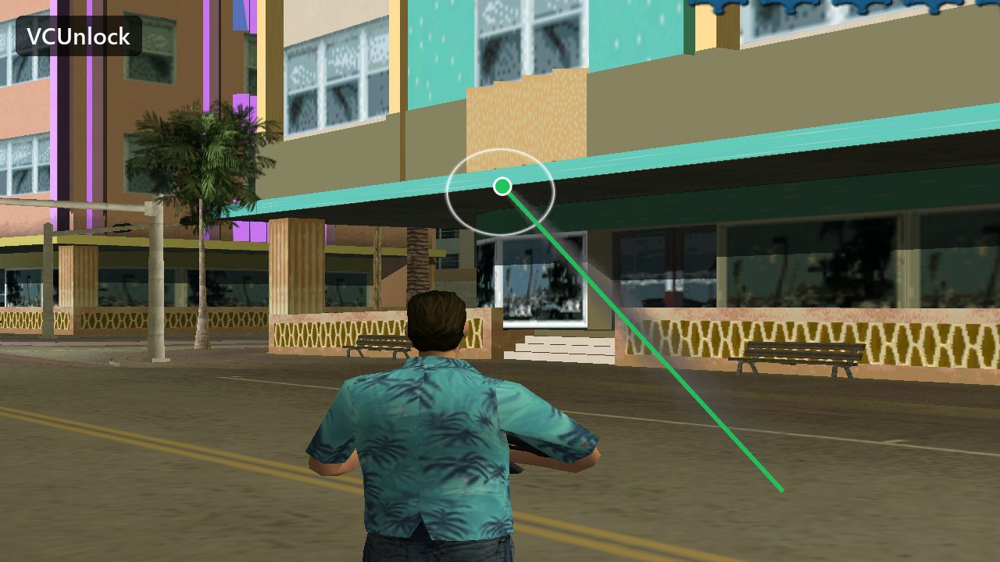</td>
  </tr>
  <tr>
    <td colspan="2"><b>Wide Screen on</b>: the original's shot lands above and right of the crosshair</td>
  </tr>
  <tr>
    <td>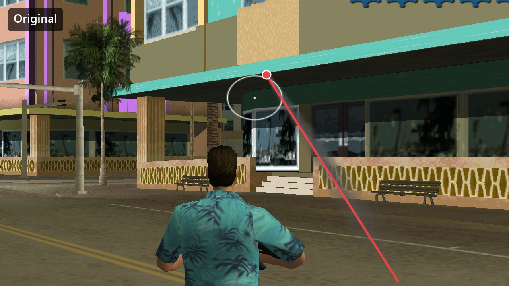</td>
    <td>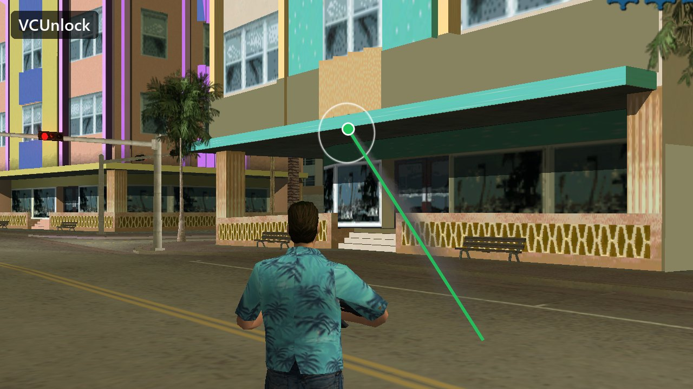</td>
  </tr>
</table>

## Tested

Same vehicle, same place and the same scripted input, recorded from the game at 240 fps:

| | VCUnlock | Original, limiter off |
|---|---|---|
| World updates per second | 30.00 | 240, one per frame |
| Game clock | Real time | 8% slow |
| Infernus coasting | Same as 30 fps | Stops dead in 1.5 s |
| Maverick climb | Same as 30 fps | 79 m up in 7 s instead of 67 |
| Speeder at full throttle | Same as 30 fps | 60 to 90 km/h instead of 120 |
| Skimmer on water | Same as 30 fps | 18 km/h instead of 60 |
| Boat in reverse | Same as 30 fps | 18 km/h instead of 14 after 2 s |

Also checked:

- Vehicle lights, wheels, doors and bike lean sit where the vehicle is drawn, on every frame.
- Every per-frame fix that was removed got a breakpoint. None fired outside a world update.
- Draw distance stress test with a sniper zoom: 480 of 16,384 list entries and 75 MB of streaming memory used.
- 7 of 7 alt-tabs in exclusive fullscreen worked.
- The 30 Hz world and the draw distance code run against a copy of the Steam executable in offline tests.
- On retail 1.0 and the Japanese release every change goes in, the same as on Steam, and the world keeps 30 updates a second.
- With SilentPatch (Build 12.1 and its DDraw component) and Ultimate ASI Loader 9.7.4, in either load order, every VCUnlock change went in and the world kept 30 updates a second.

## Install

You need GTA Vice City from Steam, the retail CD version 1.0 or the Japanese release. Other versions, such as retail 1.1, the Rockstar Games Launcher and the Definitive Edition, are not supported. VCUnlock leaves them untouched.

To open the game folder on Steam, right-click the game and choose **Manage** → **Browse local files**. The retail game is in the folder you installed it to. Then follow the way that fits your folder.

### Without an ASI loader

Use this if you don't have an ASI loader installed.

1. Download [VCUnlock.zip](https://github.com/ilkaydnc/VCUnlock/releases/latest/download/VCUnlock.zip).
2. Extract `dinput8.dll` into the game folder, next to `gta-vc.exe`.
3. Start the game.

To uninstall, delete `dinput8.dll`.

### With an ASI loader

Use this if you already have an ASI loader installed, for example for SilentPatch. The loader is often a `dinput8.dll` of its own: keep it and add VCUnlock as one more `.asi` file.

1. Download [VCUnlock-ASI.zip](https://github.com/ilkaydnc/VCUnlock/releases/latest/download/VCUnlock-ASI.zip).
2. Extract `VCUnlock.asi` into the folder that holds your other `.asi` files. That is usually the game folder, or its `scripts` or `plugins` folder.
3. Start the game.

To uninstall, delete `VCUnlock.asi`.

## Settings

Everything is in **Options** → **Display Setup** and **Audio Setup**:

| Setting | Values |
|---|---|
| Frame Limiter | VSYNC, 30, 60, 120, 144, 165, 240, OFF |
| Wide Screen | ON, OFF |
| Screen Resolution | Borderless, windowed, or fullscreen at each refresh rate |
| Show FPS | ON, OFF |
| Mute In Background | ON, OFF |

<table>
  <tr>
    <th>Original</th>
    <th>VCUnlock</th>
  </tr>
  <tr>
    <td colspan="2"><b>Display Setup</b>: Frame Limiter, Screen Resolution and Show FPS</td>
  </tr>
  <tr>
    <td>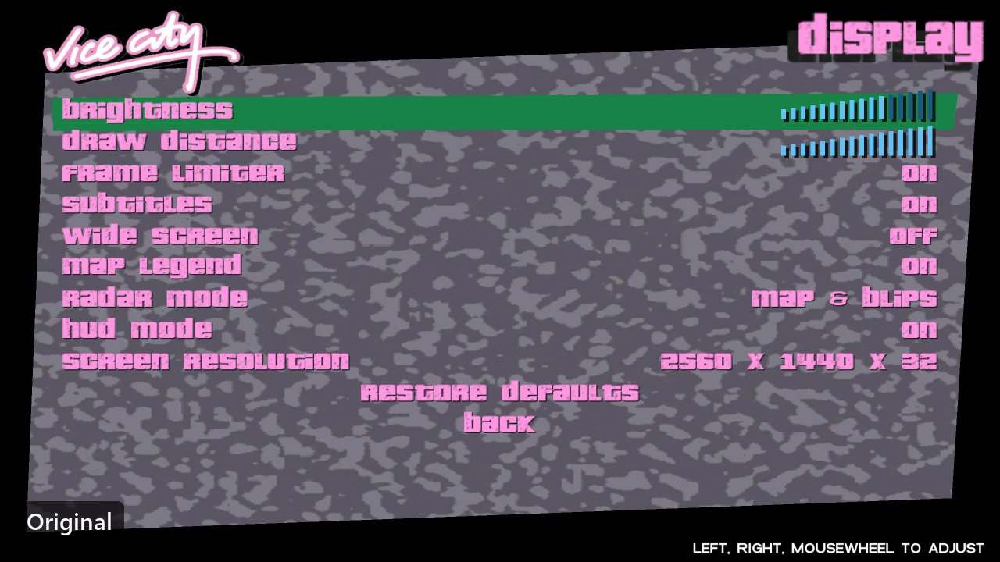</td>
    <td>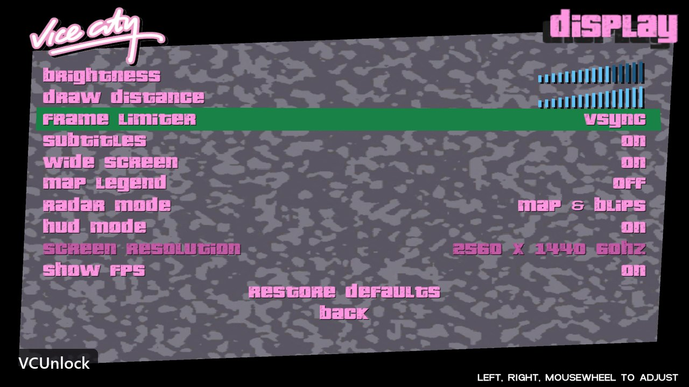</td>
  </tr>
  <tr>
    <td colspan="2"><b>Audio Setup</b>: Mute In Background</td>
  </tr>
  <tr>
    <td>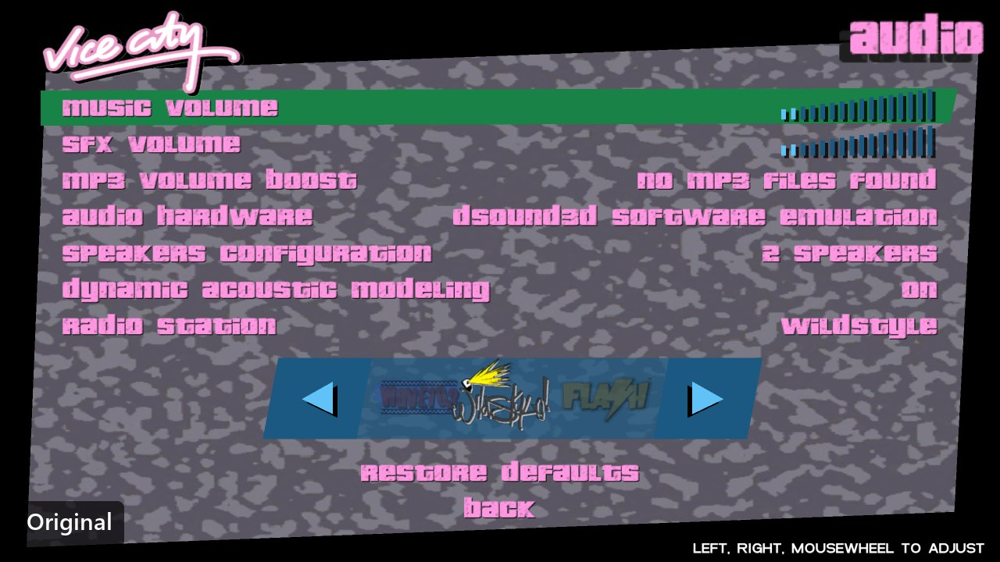</td>
    <td>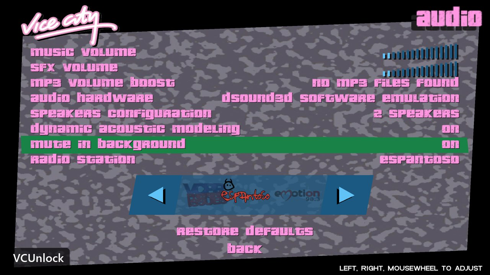</td>
  </tr>
</table>

Settings are saved in `Documents\GTA Vice City User Files\VCUnlock.ini`, which has a few extra options:

| Key | Default | What it does |
|---|---|---|
| `Width`, `Height` | `0` | Window size. `0` uses 75% of the desktop |
| `FPSLimit` | `0` | Any frame rate cap, also one that isn't in the menu |
| `PauseOnFocusLoss` | `1` | Pause when you alt-tab |
| `SkipIntro` | `0` | Skip the logo movies |
| `Log` | `0` | Write `VCUnlock.log` |

## Troubleshooting

**Nothing changed in the game.** Make sure `dinput8.dll` sits next to `gta-vc.exe`, or `VCUnlock.asi` next to your other `.asi` files. Set `Log=1` and check `VCUnlock.log`. VCUnlock checks the game's code before every change and skips anything that doesn't match. If the log says "unsupported executable", your game version is not one VCUnlock knows.

**Another mod uses `dinput8.dll`.** That is usually an ASI loader: use `VCUnlock.asi` instead. Remove other frame rate, widescreen and window mods first.

**Antivirus warning.** Every release is built by [GitHub Actions](https://github.com/ilkaydnc/VCUnlock/actions/workflows/build.yml) from this source. You can check your download against `SHA256SUMS.txt` on the release page.

**Found a bug?** Open an [issue](https://github.com/ilkaydnc/VCUnlock/issues) and attach `VCUnlock.log` and `VCUnlock.ini`.

## Building

You need Visual Studio 2022 or newer with the **Desktop development with C++** workload.

```bat
build.bat
```

The DLL is written to `build\dinput8.dll`, with a copy named `build\VCUnlock.asi`. Pushing a tag such as `v1.0.0` publishes a release.

## Special thanks

 **[Root1X](https://www.twitch.tv/root1x)** made VCUnlock with me, from the first idea to the release.

 **[YBurakD](https://www.twitch.tv/yburakd)** played build after build and gave the feedback that shaped the fixes.

## Licence

VCUnlock is released under the [MIT Licence](LICENSE).
